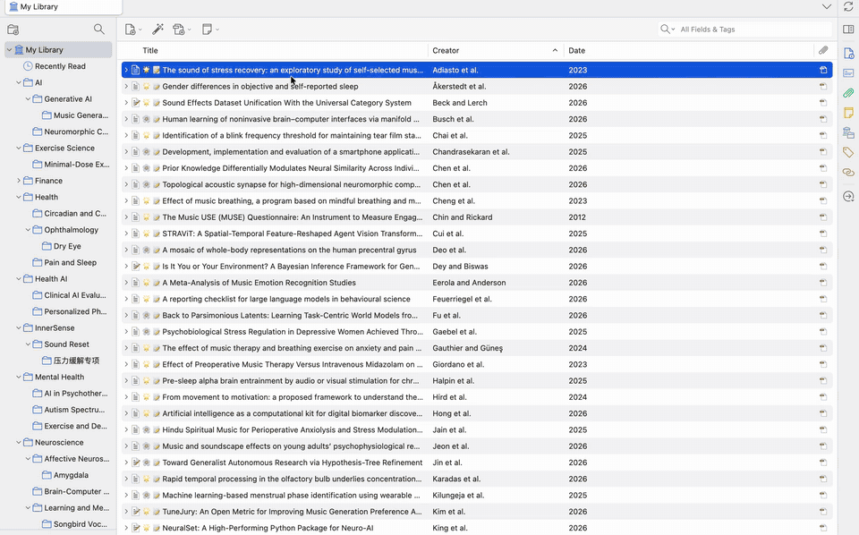

# Mktero

**English** · [简体中文](./README.zh-CN.md)

[](https://github.com/tenglvjun/mktero/actions/workflows/test.yml)
[](https://github.com/tenglvjun/mktero/releases/latest)
[](./LICENSE)
[](https://www.zotero.org/)

**Read Zotero PDFs as source-linked Markdown.**

Mktero is a restartless Zotero extension for Zotero 7, 8, 9, and 10. When you
request a new conversion without a usable cache, the default converter sends
that local PDF through your Mktero account. No MinerU or Mistral key is required. [MinerU](https://mineru.net/)
and [Mistral OCR 4.1](https://docs.mistral.ai/models/ocr-4-1) remain available
if you do not want the PDF sent to Mktero. The result opens as Markdown,
formulas, tables, figures, citations, and annotations in a temporary,
reading-first Zotero tab. A content-addressed local cache avoids repeating
conversions for the same PDF and parser profile. You can also explicitly import
supported local llm-for-zotero MinerU results without an account, API key, or
another upload.

[Download](https://github.com/tenglvjun/mktero/releases/latest) ·
[Product page](https://mktero.com/) ·
[Documentation](#documentation) ·
[Community](#community) ·
[Support Mktero](#support-mktero)

> [!IMPORTANT]
> Mktero is in beta. Requesting an uncached conversion with the default converter
> sends the complete PDF to the Mktero service for your account. Sign in from `Settings -> Mktero`;
> no separate OCR key is required. If you switch to MinerU or Mistral, the PDF
> goes to that service instead and is not sent to Mktero. Optional AI translation
> sends protected Markdown batches to the provider configured by you. Review
> [Privacy and data handling](./docs/privacy.md) before processing sensitive
> documents.



## Contents

- [Features](#features)
- [Quick start](#quick-start)
- [Documentation](#documentation)
- [Privacy](#privacy)
- [Development](#development)
- [Community](#community)
- [Contributing](#contributing)
- [Support Mktero](#support-mktero)
- [License](#license)

## Features

### Reading

- Reflow OCR output, multi-column text, formulas, tables, figures, lists, and
  code into a continuous academic reading document. For MinerU documents,
  PDF-native safe HTTP(S) link annotations and MinerU hyperlinks retain their
  original destinations, including URLs containing underscores, rather than
  guessing a target from the visible text.
- Hide publisher mastheads, first-page copyright notices, repeated headers and
  footers, and page numbers, and keep reliable page/region mappings so text,
  formulas, tables, and figures can jump back to their PDF source. A PDF text
  selection can open its Markdown paragraph when that mapping is unique.
- In MinerU results, show page footnotes as notes after the paragraph that
  cites them, and fold article metadata, author biographies, and reporting
  summaries into collapsed sections, so the first screen shows the title,
  authors, and abstract. Long article titles keep their heading style;
  confirmed publisher covers lose their platform controls and duplicate
  title/byline while useful publication fields stay in article information.
  The PDF's own text layer, read locally, also rejoins a
  paragraph a page or column break splits at a full stop, levels the
  headings of a paper without section numbers by their type, and, in a
  typeset PDF, restores single words the OCR model "corrected" (a name, an
  author's spelling) to the printed text.
- Browse the outline or a figure/table index, preview citations, affiliations,
  figures, and tables, and find text in the body with `Cmd/Ctrl+F`.
- Copy a display formula's LaTeX, a code block's text, or a table as Markdown
  or CSV without leaving the reader. These actions read the rendered document
  and never change the cached Markdown. A copy from the reader, by keyboard or
  by these actions, is standard Markdown with its formulas as `$…$` and `$$`
  TeX, so it pastes with its formulas rendered into a Zotero note and into a
  Markdown editor that renders TeX math.
- Rebuild figures from the local PDF when layout evidence, page coordinates,
  and Markdown ranges agree. Restoration runs in a background worker and
  replaces placeholders in place, so slow figures never block reading.

### Annotations and translation

- Display Zotero PDF highlights and underlines in Markdown, and create, recolor,
  comment on, or delete annotations. The reader's Notes column shows the
  current item's child notes and standalone notes from the same Zotero library
  in separate tabs; other papers' child notes are not shown. Edit either kind
  with Zotero's native note editor, create either kind from the plus menu, and
  add the current paper's passages and citations to an open standalone note.
- Correct recognition errors in existing paragraphs, headings, and GFM table
  cells without modifying the immutable OCR result.
- Translate a complete article through a configured Vercel AI SDK provider and
  switch between Original, Translation, and continuous Bilingual reading; look
  up a selected term or passage on demand.

### Library and export

- Explicitly import a supported local llm-for-zotero MinerU result from a PDF
  or its parent item's context menu. Mktero reads the source cache without
  changing it, saves its own local copy, and opens the normal reader.
- Check whether each Markdown reference already exists in any accessible
  Zotero library, copy a reference from another library, and import missing
  metadata with an optional public PDF attachment.
- Explore direct reference relationships among papers already in the current
  Zotero library, using Semantic Scholar, OpenCitations, and OpenAlex when
  identifiers are available.
- Save a portable Zotero snapshot, or export corrected Markdown and its
  extracted figures to a local folder or an Obsidian vault. Optionally write
  already converted Markdown to an Obsidian vault in a batch.
- Show a Markdown column in the item list when this computer still has a
  readable cached conversion for the current settings or the PDF's selected
  imported result. While a PDF is queued
  or converting, that column shows a session-only spinner. The ready marker
  stays in the Zotero profile, does not modify the item, and does not sync.

The interface follows Zotero's English or Simplified Chinese display language.
Other locales fall back to English.

## Quick start

> [!TIP]
> Install the XPI, open `Settings -> Mktero`, sign in to Mktero, then open a PDF
> and click the Mktero icon in the reader toolbar.

### Requirements

- **Zotero.** Desktop `7.0` through `10.0.*`.
- **PDF.** An attachment downloaded and available as a local file.
- **Account.** A Mktero account for the default hosted conversion. Signing in
  does not require a MinerU or Mistral key.
- **Own converter, optional.** Switch to MinerU cloud, a self-hosted MinerU 4.0
  service, or [Mistral](https://console.mistral.ai/api-keys/) if you do not want
  the PDF sent to Mktero. MinerU cloud and Mistral need your own API key. A
  local MinerU key is optional.
- **Network.** Access to the Mktero service, or to the converter you selected,
  for a new conversion. Importing supported local llm-for-zotero results and
  reopening their saved copy work offline without an account or converter key;
  local caching must be enabled.

The selected converter controls file-size, page-count, quota, and
service-availability limits. When you choose MinerU or Mistral, see the
[MinerU API documentation](https://mineru.net/apiManage/docs) or
[Mistral OCR documentation](https://docs.mistral.ai/studio/document-processing/basic_ocr)
for that service's current limits. The hosted Mktero conversion and MinerU
cloud accept at most 200 pages per PDF. Before such a PDF is sent, Mktero
counts its pages locally and stops with a message when it has more; a local
MinerU service and Mistral are not checked.

When enabled by the service, a daily account quota applies to new hosted
conversion results. Settings shows the current limit, used and reserved slots,
and the reset time in your local time zone; the service counts UTC calendar
days. A quota block pauses pending hosted work in the preparation window while
submitted jobs continue. Use `Check quota and continue` or `Cancel remaining`;
there is no automatic next-day restart. Continuing is allowed even at zero
remaining capacity: the service admits a document this account already
converted without consuming quota and refuses a new document again. Reading
local results, corrections, export, your own converters, and AI translation are
unaffected.

### Install

1. Download the latest `mktero-<version>.xpi` from
   [GitHub Releases](https://github.com/tenglvjun/mktero/releases/latest).
2. In Zotero, open `Tools -> Plugins`.
3. Open the gear menu and choose `Install Add-on From File...`.
4. Select the XPI and follow Zotero's prompts.

Formal GitHub releases receive automatic updates through Zotero. Drafts and
prereleases are not offered as automatic updates.

### Configure

Open `Settings -> Mktero` after installation. The default converter is Mktero:
sign in or register there. To keep a PDF off the Mktero service, choose MinerU
or Mistral and enter that service's API key. AI features and reading options
are optional; each AI provider keeps its own model, key, and related settings.
Credentials are stored as ordinary, unencrypted preferences in the active
Zotero profile.

If the MinerU cloud API returns an authentication error (`HTTP 401` or
`token expired`), update the MinerU API key in `Settings -> Mktero`. Get a new
key from [MinerU's official API key management page](https://mineru.net/apiManage/token).
Signing in again in your browser does not automatically update the key saved
in the plugin.

See [Configuration](./docs/configuration.md) for every setting and
[Privacy and data handling](./docs/privacy.md) for what is sent where.

### Import an existing llm-for-zotero result

In Zotero's library, right-click one PDF attachment or its parent item. When a
local llm-for-zotero result is found, choose `Import parsed result from
llm-for-zotero…`; if several PDFs have results, choose the intended attachment
from the submenu. Selecting the menu item starts the import: Mktero validates
and copies the result into its own cache, then opens that PDF in the normal
Mktero tab. A failed import does not start a remote conversion.

Only supported local results can be imported; see [Workflows](./docs/workflows.md#import-a-local-llm-for-zotero-result)
for the format requirements and how to reimport or explicitly reparse. Mktero's
Markdown and raw MinerU caches do not automatically evict entries by count,
total size, or inactivity. After a PDF attachment is permanently deleted,
background checks can remove registered orphaned data with no extra retention
period once absence and lack of shared references are confirmed. Trash and
shared PDFs remain protected. Only use of the affected attachment or cache
delays cleanup; unrelated reading does not. Uncertain ownership is retained,
and failed deletions are retried. A missing PDF never pins unrelated caches: its
rebuildable caches are released, while corrections and reading positions stay.
A file that exists but cannot be verified still protects potentially shared data.
Settings show the cleanup result, reasons for retaining data, released caches,
missing local PDFs, and the next check, with a **Check again** action.
See [Local cache cleanup](./docs/workflows.md#local-cache-cleanup).
Manual clearing, self-healing of invalid entries, and profile filesystem loss
can also remove cached data; individual archive, document, image, and parsing
resource limits still apply. Deleting the llm-for-zotero source does not affect
reading while Mktero's copy remains; a retained raw result can also rebuild the
reading document offline. If all local content for the selected import is
missing, opening it later with `Read as Markdown with Mktero` uses the current
converter and may upload the PDF. Import failure, corrupt content, read errors,
or cancellation do not by themselves start a conversion.

### Open a PDF

1. Start from the PDF or library item you already have:

   - Open a PDF in Zotero and click the Mktero file icon in the reader toolbar.
   - Right-click a PDF or library item and choose `Read as Markdown with Mktero`.
   - Select several items and choose `Prepare selected Markdown` to queue them
     without opening a tab for each one.
   - Right-click a collection and choose `Prepare collection tree Markdown` to
     prepare PDFs in the collection and all its subcollections. Mktero confirms
     the number of unique PDFs before preparing. A single item still uses
     `Read as Markdown with Mktero`.

2. Follow the upload, conversion, and download progress in the temporary Mktero
   tab. A valid cache entry skips the remote conversion. A batch uses Zotero's
   progress window; minimizing it keeps preparation running.
3. Use the outline, find, citations, figure/table previews, source links, the
   Annotations segment, and the Notes column to navigate the document.

> [!NOTE]
> Mktero tabs are session-only and are not restored after Zotero restarts.
> Closing a tab does not cancel an in-progress conversion; it continues in the
> background and appears in the preparation window. Shutting down the extension
> cancels active conversion and translation requests. Each uncached PDF in a
> batch is sent the same way as a single conversion. Reopening the same PDF and
> conversion profile restores the last reading paragraph.
> Attachments with identical PDF bytes share in-progress hosted conversion within
> one Mktero runtime and account session, including with local caching disabled.
> Each attachment keeps its own reading state. See [workflows](./docs/workflows.md)
> for cancellation and forced-reparse behavior.

## Documentation

| Guide | What it covers |
| --- | --- |
| [Configuration](./docs/configuration.md) | Every setting and its default |
| [Reading and annotation workflows](./docs/workflows.md) | Corrections, annotations, Zotero notes, AI translation, citations, references, snapshots, and export |
| [Figure pipeline](./docs/figure-pipeline.md) | How figures are rebuilt from the local PDF |
| [Privacy and data handling](./docs/privacy.md) | What Mktero sends and where it is stored |
| [Limitations](./docs/limitations.md) | Supported PDFs, navigation, and resource limits |
| [Development](./docs/development.md) | Build, test, figure corpus, and contributing |

## Privacy

- Requesting an uncached conversion with the default converter sends the
  complete PDF to the Mktero service for your account.
- If you select MinerU cloud, a local MinerU service, or Mistral, the complete
  PDF is sent there instead, and not to Mktero.
- Explicit imports of supported local llm-for-zotero results read the source
  cache without changing it and save a separate, unencrypted local copy and
  import selection. Import and local reopening do not upload the PDF or results,
  even if the source cache has been deleted. Retained raw results can rebuild
  the document offline. If all local content for a selected import is missing,
  a later `Read as Markdown with Mktero` uses the current converter and may
  upload the PDF, as does an explicit reparse. Import failure, corrupt content,
  read errors, or cancellation do not themselves trigger conversion.
- Credentials, cached Markdown and figures, stored MinerU results (without the
  PDF copy), corrections, translations, reading positions, local highlights not
  yet in the PDF, and the Zotero annotation keys that tie a cross-page
  highlight together are stored unencrypted in the active Zotero profile and
  are not synced by Mktero.
- Signing in for the default conversion sends the email and password only when
  you sign in. Registration also emails a verification code. The access token
  and refresh token stay in the same profile. While the account pane is open,
  the extension uses that token to request your profile and your
  conversion-activity counts from the service you selected, and shows them as
  the account card's counters. The pane also reads daily quota balances when
  supported, and refreshes them after hosted requests finish. The service keeps
  account-linked admissions, usage, page counts, reuse and quota-block aggregates
  for service operation and capacity planning; pending local batch lists are
  not uploaded.
- The extension reports its own version to the Mktero service when you sign in,
  refresh your token, or send a background heartbeat, so the operator can see
  which builds are still in use. That report carries no device fingerprint and no hardware,
  operating-system, or IP-derived identifier, runs no third-party analytics, is
  never attached to a request that goes to a converter or provider you
  configure, and is not part of your account profile.
- Reference, citation, and translation requests are bounded and local-first;
  logs never contain API tokens, presigned URLs, PDF bytes, or authenticated
  responses.

Full details and the complete data table are in
[Privacy and data handling](./docs/privacy.md).

## Development

Use the Node.js version in [`.node-version`](./.node-version), currently
`24.15.0`. Node.js 25 is outside the supported dependency range.

```bash
npm ci
npm run check
npm test
npm run build
```

See [Development](./docs/development.md) for the figure corpus regression.

## Community

Usage questions can go to the QQ group, WeChat, or
[Discord](https://discord.gg/uyxmxah2sh). Ideas, reading workflows, and beta
feedback belong in
[GitHub Discussions](https://github.com/tenglvjun/mktero/discussions).
Reproducible bugs belong in
[GitHub Issues](https://github.com/tenglvjun/mktero/issues).

To report a problem, use Help > Report a Mktero Problem, the Report a problem
button on a failed conversion, or the document actions menu of a Mktero tab. It
copies or saves a redacted diagnostic file on this computer and does not upload
it; paste it into an issue or send it to the group.
Do not paste API keys, PDF contents, or logs that contain credentials into the
QQ group, WeChat, Discord, issues, or pull requests.

QQ is a group: scan the code, or search `616518076` in QQ.

<table>
  <tr>
    <td align="center" width="220">
      <br>
      <b>QQ</b>
    </td>
    <td align="center" width="220">
      <br>
      <b>WeChat</b>
    </td>
  </tr>
</table>

## Contributing

Pull requests are welcome. For changes to runtime behavior, run the complete
verification commands above and include tests for the affected behavior.

- Ideas, reading workflows, and beta feedback:
  [GitHub Discussions](https://github.com/tenglvjun/mktero/discussions)
- Usage questions: [Community](#community)
- Reproducible bugs:
  [GitHub Issues](https://github.com/tenglvjun/mktero/issues)

Please keep credentials, private PDFs, and other sensitive data out of the QQ
group, WeChat, Discord, issues, pull requests, and logs.

## Support Mktero

If Mktero makes reading papers easier for you, consider buying me a coffee.
Your support helps with ongoing development, maintenance, and hosting costs.

[](https://ko-fi.com/tenglvjun)

## License

[MIT](./LICENSE) © 2026 Tony
