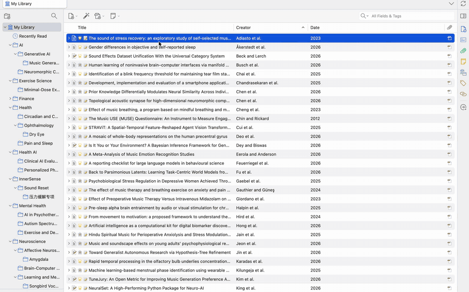

# Mktero

[English](./README.md) · **简体中文**

[](https://github.com/tenglvjun/mktero/actions/workflows/test.yml)
[](https://github.com/tenglvjun/mktero/releases/latest)
[](./LICENSE)
[](https://www.zotero.org/)

**在 Zotero 中以带来源链接的 Markdown 阅读 PDF。**

Mktero 是适用于 Zotero 7、8、9 和 10 的无需重启扩展，将 PDF 中的正文、公式、表格、图片、引用和注释呈现在临时的 Markdown 阅读标签页中。
内容寻址的本地缓存会复用相同 PDF 和解析配置的结果，避免重复转换。

[下载最新版本](https://github.com/tenglvjun/mktero/releases/latest) ·
[产品介绍页](https://mktero.com/) ·
[文档](#文档) ·
[社区](#社区) ·
[支持 Mktero](#支持-mktero)

> [!IMPORTANT]
> Mktero 目前处于 Beta 阶段。主动请求未缓存的转换且使用默认转换服务时，完整 PDF 会发送到你账号所使用的 Mktero 服务。
> 在 `设置 -> Mktero` 登录即可，无需另外的 OCR 密钥。若改用
> [MinerU](https://mineru.net/) 或 [Mistral OCR 4.1](https://docs.mistral.ai/models/ocr-4-1)，PDF 改发到那里，不再发到 Mktero。
> 可选的 AI 全文翻译会把带原句编号的受保护 Markdown 发送给你配置的 AI 服务商，不经过 Mktero 翻译服务。处理敏感文档前，请阅读[数据与隐私](./docs/privacy.zh-CN.md)。



## 核心能力

### 阅读

- 在阅读器工具栏的`排版`中调整正文字体、字号、行距、栏宽和对齐方式。选择字体后立即生效，也可在同一面板关闭 PDF 原文缩略图。[阅读排版](./docs/reading.zh-CN.md#调整阅读视图)
- 将双栏论文重排为连续正文，保留公式、表格、列表和代码，并隐藏刊头、页眉页脚等页面装饰。算法步骤中相邻的行内公式保持各自独立的 `$…$` 边界，分隔符不会粘连为 `$$`；普通文本、缩进、代码块和合法的块级公式保持原样。[阅读](./docs/reading.zh-CN.md)
- 在 MinerU 文档中关联公式与编号，包括排在公式右下方的编号。公式尾部被误放进编号标签时，只有独立编号以及 PDF 文字和位置共同验证后，才将它恢复到公式正文。合法的复杂标签完整保留，无法排版的公式仍显示为可查看的源码；阅读、复制和导出使用同一份恢复后的 TeX。[公式处理](./docs/reading.zh-CN.md#复制公式代码块与表格)
- 在原文、译文和双语视图中浏览同一套章节层级。通过目录、图表、引用和查找定位，在 Markdown 与 PDF 来源之间跳转。[文档导航](./docs/reading.zh-CN.md#在文档中定位)
- 将鼠标停留在正文的图、表或论文引用上即可预览，滚动和选中文字时不会自动弹出。[引用预览](./docs/reading.zh-CN.md#在文档中定位)
- 预览用逗号或分号分隔的作者—年份分组引用中匹配到的文献，支持方括号格式。[参考文献匹配](./docs/references-and-export.zh-CN.md#参考文献匹配)
- 参考文献被方法等章节分成多段时，仍可预览并跳转到编号对应的条目。[参考文献匹配](./docs/references-and-export.zh-CN.md#参考文献匹配)
- 在阅读器内复制公式 LaTeX、代码，或将表格复制为 Markdown、CSV。[复制操作](./docs/reading.zh-CN.md#复制公式代码块与表格)
- 阅读时在后台从本地 PDF 恢复图组，保留共享图注（包括图号后使用破折号的格式），也支持能核验原始图片的无编号图形摘要。对于 MinerU，还会用 PDF 自带的文字层恢复 OCR 丢失、拆开或挂错浮动块的图号和图题，并保留印刷原文；共享图题描述多排带字母的面板时，Mktero 先核验完整图片连通组和唯一图题，因此写成 `(a–f)` 或 `(a–i)` 的图组仍合并为一张图，不要求来自单一原生 PDF 图片。已经挂在所属子图上的框外字母，在完整 PDF 图注、闭合图组和有界的唯一归属检查一致时，按原位置保留在裁图中；栅格字母不要求另有 PDF 文字项，移到其他子图仍须原生文字证据。存在冲突的图组在回退时也保持完整。印在图内的短坐标轴说明会与 PDF 文字核对并保留为图内文字：它不会充当图片自己的图注，只有裁图成功后才离开阅读流。短标题被误归为其他浮动块的原始脚注时，只有原生全文、完整共享图注和无遮挡的唯一图片归属共同核验通过，才将标题纳入裁图；核验会拼接紧贴的 PDF 字形片段，原始碎片仍可追溯，裁图失败时文字继续保留在阅读流中。表格与统计图混合的图组须有唯一原生 PDF 图片、完整共享图注和每个 OCR 碎片的像素核验；碎片数可以不同于逻辑面板数，核验通过的裁图仍保留位图外的矢量边缘。满宽多行图注保持完整（包括末词止于行尾连字符、OCR 副本继续该词的情况），两排子图之间的编号图注会隔开相邻图组，各图组仍保留 PDF 布局。完整图注被误识别为图片上方、下方或侧边的独立正文段落时，PDF 文字核实整个区域且唯一确定归属后，也可将其关联到图片并只输出一次；证据不足的内容保持原位。全文核验可归一 PDF 中已由 OCR 识别的图注开头关键词的字距，如 `F I G U R E`；图号和说明仍须一致。双栏 PDF 的行基线重合且栏沟较窄时，会依据独立段落或完整编号图注的布局边界切分原生文字段，并按每段自身的字高和基线读取，避免将邻栏正文混入图注或虚构第二份同号图注，使已有共享图注的多图组规则继续生效。带字母的子图说明被误当成整图图注时，只有唯一原生 PDF 图片包含这些说明，且图片像素与完整外部图注共同核验通过，才会将说明保留在恢复图片内。单个整页图组的面板字母与紧邻下一页顶部的唯一图注对应、图注页不含其他图组且没有正文造成归属冲突时，也可恢复，无需“See next page”提示；其余情况保持服务返回的原样。[图组恢复流程](./docs/figure-pipeline.zh-CN.md)

### 注释、校对和翻译

- 显示和编辑 PDF 高亮、下划线，通过 PDF 位置和前后文区分重复段落，并用 Zotero 原生编辑器写条目笔记或独立笔记。在`译文`视图或`双语`视图的译文侧，拖选译文，松开鼠标后即可看到对应原句或句组。点颜色或写评论只会标注能确认的原句或句组。已有 PDF 注释若落在一个已验证的原文句子或句组内，会高亮对应的完整译文单元，并标为`按整句定位`。如果只能找到对应段落，点`前往原文标注`就能自己选定范围。一次最多涉及 8 个原文块。高亮写入 Zotero PDF 后，阅读器会显示确认提示。保存会创建注释，不会新建或写入 Zotero 笔记。原文、译文和双语视图共用这条注释。[注释与笔记](./docs/annotations.zh-CN.md)
- 从`笔记`栏创建或选择一篇 Zotero 独立笔记作为研究笔记，在同一文库的多篇论文、新阅读标签页和重启 Zotero 后持续使用。加入带出处的段落后，可关闭的提示会引导你直接在原生笔记编辑器中写下疑问、质疑或联想。可按需展开默认收起的`思考角度`，查看四个静态问题；提示和问题均不写入笔记。使用「重读摘录」优先在本地 Markdown 中回看多篇论文的关键段落，需要时回到 PDF 原页，并在笔记中记录这些段落怎样改变了你的问题。[研究笔记](./docs/annotations.zh-CN.md#围绕一篇研究笔记阅读多篇论文)
- 打开 Zotero 原生侧栏查看当前文献。它与 Mktero 的`笔记`共用右侧空间：展开原生侧栏会临时隐藏笔记，关闭后按之前的笔记展开意图恢复；主动展开笔记会关闭原生侧栏。原生笔记面板目前按文库浏览，当前论文的笔记交互请继续使用 Mktero 的`笔记`。第三方插件中依赖真实 Zotero Reader 或 PDF 选区的功能，不会自动兼容 Mktero。[侧栏与布局](./docs/annotations.zh-CN.md#侧栏与布局保存)
- 选择图注中的文字或公式并保存高亮。在译文和双语视图中，都可以拖选译文图注并确认要标注的原文。已保存的高亮在译文视图显示于对应译文，在双语视图显示于原文图注。Mktero 能通过保留的图号和图片路径定位已有译文的整段图注。高亮可匹配 PDF 同页内换行的中文原文。跨页高亮可排除位于页面边缘、与正文分离的重复声明。重新打开 PDF 高亮时，也会处理断词及复合词中的行尾连字符。[选区与匹配](./docs/annotations.zh-CN.md#选区文本与定位)
- 校对段落、标题和 GFM 表格单元格，保留不可变的 OCR 结果。[校对](./docs/annotations.zh-CN.md#校对识别错误)
- 通过你配置的 AI 服务商翻译全文或选区。选区译文和对应原文弹窗都能排版行内公式与独立公式。图注译文中的行内公式可在译文和双语视图中正常显示。在`译文`视图或`双语`视图的译文侧，拖选文字并松开鼠标后，会弹出对应原文，可在框内滚动阅读、复制原文，或点击`前往原文`查看上下文。`返回译文`恢复原视图、阅读位置和选区。这些阅读操作不需要网络请求或重新翻译。全文翻译规则更新后，点击`翻译全文`可按新规则生成译文，服务商可能收费。[AI 翻译](./docs/reading.zh-CN.md#使用-ai-翻译)

### 文库与导出

- 导入受支持的 llm-for-zotero 本地 MinerU 结果，无需账号、API 密钥或再次上传。[导入结果](./docs/conversion.zh-CN.md#导入-llm-for-zotero-本地结果)
- 在可访问的 Zotero 文库中检查引用，复制已有条目，或导入缺失的元数据与可选的公开 PDF。[参考文献](./docs/references-and-export.zh-CN.md#从-markdown-导入参考文献)
- 借助 Semantic Scholar、OpenCitations 和 OpenAlex，浏览当前文库内的直接引用关系。[引用图谱](./docs/references-and-export.zh-CN.md#浏览引用图谱)
- 保存便携 Zotero 快照，或将校对后的 Markdown 和图片导出到本地文件夹。[保存与导出](./docs/references-and-export.zh-CN.md#保存便携快照)
- 将当前阅读视图导出为 EPUB，公式以图片保留排版以兼容阅读器，正文与表格中的受支持粗体记号、彩色边框保持一致；也可对整批所选文献或整个分类树批量导出快照、Markdown、EPUB 和 Obsidian 笔记。[EPUB](./docs/references-and-export.zh-CN.md#导出-epub) · [Obsidian](./docs/references-and-export.zh-CN.md#导出到-obsidian) · [批量导出](./docs/references-and-export.zh-CN.md#批量导出)
- 在文献列表的本地 Markdown 列中查看缓存可用状态与准备进度。[Markdown 状态](./docs/conversion.zh-CN.md#查看哪些条目已有-markdown)

## 快速开始

1. 从 [GitHub Releases](https://github.com/tenglvjun/mktero/releases/latest) 下载最新的 `mktero-<version>.xpi`，安装到 Zotero。
2. 打开 `设置 -> Mktero`，登录、注册账号，或选择自备的转换服务。
   使用自己的 MinerU 云端密钥时，`解析模型`可为 MinerU 云端操作选择 `VLM`（默认）或 `Pipeline`；每次操作开始时即固定，之后的修改只影响后续操作。Mktero 托管转换由服务端决定模型，该设置不作用于它。
3. 打开 PDF 并点击阅读器工具栏的 Mktero 图标，或右键 PDF，选择`使用 Mktero 阅读 Markdown`。
4. 等待转换完成后，用目录、查找、预览和来源链接阅读。命中有效缓存时会跳过远程转换。

使用要求、安装步骤与转换服务设置见[快速上手](./docs/getting-started.zh-CN.md)。

## 文档

| 文档 | 内容 |
| --- | --- |
| [快速上手](./docs/getting-started.zh-CN.md) | 准备条件、安装和第一篇 PDF |
| [阅读](./docs/reading.zh-CN.md) | 导航、来源跳转、复制、排版和翻译 |
| [注释、笔记与校对](./docs/annotations.zh-CN.md) | PDF 注释、Zotero 笔记和识别纠错 |
| [参考文献与导出](./docs/references-and-export.zh-CN.md) | 文献导入、引用图谱、快照和导出 |
| [转换与本地缓存](./docs/conversion.zh-CN.md) | 转换服务、额度、批量准备、导入和清理 |
| [配置](./docs/configuration.zh-CN.md) | 所有设置项及默认值 |
| [数据与隐私](./docs/privacy.zh-CN.md) | 发送内容、存储位置和同步规则 |
| [当前限制](./docs/limitations.zh-CN.md) | 支持的 PDF、导航方式和资源上限 |
| [图组恢复流程](./docs/figure-pipeline.zh-CN.md) | 如何从本地 PDF 重建图组 |
| [开发](./docs/development.zh-CN.md) | 构建、测试、浏览器预览和回归语料 |

按任务查阅可使用[工作流索引](./docs/workflows.zh-CN.md)。

## 数据与隐私

- 主动请求未缓存的转换且使用默认转换服务时，完整 PDF 会发送到你账号所使用的 Mktero 服务。
  复用托管转换缓存前，轻量查询只发送 PDF 的 SHA-256、字节大小和内容类型，不发送 PDF 字节，也不占转换额度。
  服务端保存与账号关联的 PDF 标识和解析路由。模型变化可能需要重新转换和上传；仍保留的匹配结果可以复用。
  托管结果 ZIP 闲置达到设定期限后会被删除，默认期限为 14 天。
- 若改选 MinerU 云端、本地 MinerU 服务或 Mistral，完整 PDF 改发到那里，不再发到 Mktero。直连 MinerU 云端的请求还会带上该次操作开始时固定的解析模型。
- 导入 llm-for-zotero 本地结果时不改动源缓存，另存未加密的副本和导入选择。导入及本地重开不上传 PDF 或结果；
  如果本地内容全部缺失，之后普通打开可能上传 PDF。主动重新解析也可能上传。导入失败、内容损坏、读取错误或取消不会触发转换。
- 凭据、缓存的 Markdown 和图片、MinerU 原始结果（不含 PDF）、校对、译文及其与原句的对应关系、阅读位置、尚未写入 PDF 的本地高亮，
  以及跨页高亮的注释 key，均未加密地保存在 Zotero 配置文件中。Mktero 不同步这些数据。
- 个人文库可选择将已完成的全文译文保存为独立附件，通过 Zotero 文件同步复用。见[同步已完成的全文译文](./docs/reading.zh-CN.md#同步已完成的全文译文)。
- 研究笔记偏好只将文库 ID 和笔记 key 未加密地保存在本地 Zotero 配置文件中；Mktero 不发送或同步这项偏好。
  笔记仍是普通 Zotero 笔记，由 Zotero 保存，并按你的 Zotero 设置同步。
- 登录会发送邮箱和密码，注册还会向邮箱发送验证码。令牌保存在配置文件中。账号面板会读取资料、转换计数与服务支持的每日额度；
  服务端保留关联账号的使用聚合，用于服务运行与容量规划。本地待处理批次不会上传。
- 登录、刷新令牌和后台心跳时，仅向 Mktero 上报扩展版本，不含设备指纹、硬件、操作系统或由 IP 推导的标识，
  不接入第三方统计，不附加到发往你配置的其他服务的请求中，也不属于账号资料。
- 每日阅读活动计数（打开的阅读标签页数、打开的不同 PDF 数、其中滚动过和读到一半以上的篇数，以及注释、导出和翻译的次数）
  会上报 Mktero，便于运营方判断一次转换是否真的被读过。这些数字不含论文标识、标题、路径或文字内容，
  并且只在转换服务选择 Mktero 托管转换时发送：改用自己的 MinerU 或 Mistral 服务会立即停止上报。
- 引用、文献和翻译请求都有范围限制，优先使用本地数据。日志不会包含 API Token、预签名地址、PDF 字节或带认证的响应。

完整说明、本地导入副本的保留规则及数据表见[数据与隐私](./docs/privacy.zh-CN.md)。

## 开发

使用 [`.node-version`](./.node-version) 指定的 Node.js 版本，目前为 `24.15.0`。Node.js 25 不在支持范围内。

```bash
npm ci
npm run check
npm test
npm run build
```

浏览器预览和回归语料见[开发](./docs/development.zh-CN.md)。

## 社区

使用问题可以进 QQ 群、微信，或加入 [Discord](https://discord.gg/uyxmxah2sh)。功能想法、阅读工作流和 Beta 反馈请前往
[GitHub Discussions](https://github.com/tenglvjun/mktero/discussions)。可复现的问题请提交到
[GitHub Issues](https://github.com/tenglvjun/mktero/issues)。

从`帮助 > 报告 Mktero 问题…`、转换失败时的`报告问题`按钮，或 Mktero 标签页的 `⋯ > 报告问题`，
可以在这台电脑上复制或保存脱敏诊断文件，不会上传；把文件粘贴到 Issue 或发到群里即可。
请勿在 QQ 群、微信、Discord、Issue、Pull Request 或日志中提交 API Key、其他凭据、私密 PDF 原文或其他敏感数据。

欢迎提交 Pull Request。修改运行时行为时，请运行上面的完整验证命令，并为受影响的行为补充测试。

QQ 是用户群：可以扫码，也可以在 QQ 中搜索群号 `616518076`。

<table>
  <tr>
    <td align="center" width="220">
      <br>
      <b>QQ</b>
    </td>
    <td align="center" width="220">
      <br>
      <b>微信</b>
    </td>
  </tr>
</table>

## 支持 Mktero

如果 Mktero 让你阅读论文更轻松，欢迎请我喝杯咖啡。
你的支持将用于项目的持续开发、维护和托管费用。

[](https://ko-fi.com/tenglvjun)

## License

[MIT](./LICENSE) © 2026 Tony
