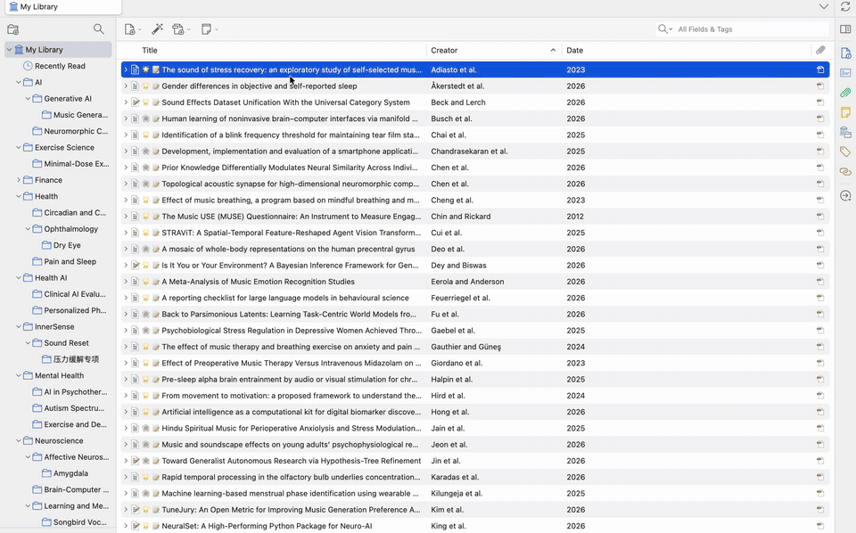

# Mktero

[English](./README.md) · **简体中文**

[](https://github.com/tenglvjun/mktero/actions/workflows/test.yml)
[](https://github.com/tenglvjun/mktero/releases/latest)
[](./LICENSE)
[](https://www.zotero.org/)

**在 Zotero 中以带来源链接的 Markdown 阅读 PDF。**

Mktero 是适用于 Zotero 7、8、9 和 10 的无需重启扩展。主动请求新的转换且没有可用缓存时，默认转换会把这份本地 PDF
经你的 Mktero 账号发送出去，不需要 MinerU 或 Mistral 密钥。如果不想把 PDF 交给 Mktero，仍可以改用
[MinerU](https://mineru.net/) 或 [Mistral OCR 4.1](https://docs.mistral.ai/models/ocr-4-1)。
结果会在临时的阅读优先 Zotero 标签页中打开，包括 Markdown、公式、表格、图片、引用和注释。内容寻址的本地缓存会按 PDF 内容和解析配置复用转换结果，避免重复处理。也可以显式导入受支持的 llm-for-zotero 本地 MinerU 结果，无需账号、API 密钥或再次上传。

[下载最新版本](https://github.com/tenglvjun/mktero/releases/latest) ·
[产品介绍页](https://mktero.com/) ·
[文档](#文档) ·
[社区](#社区) ·
[支持 Mktero](#支持-mktero)

> [!IMPORTANT]
> Mktero 目前处于 Beta 阶段。主动请求未缓存的转换且使用默认转换服务时，完整 PDF 会发送到你账号所使用的 Mktero 服务。
> 在 `设置 -> Mktero` 登录即可，不需要另外的 OCR 密钥。若改用 MinerU 或 Mistral，PDF 改发到那里，不再发到 Mktero。
> 可选的 AI 翻译会把受保护的 Markdown 批次发送给你配置的 Provider。处理敏感文档前，请阅读[数据与隐私](./docs/privacy.zh-CN.md)。



## 目录

- [核心能力](#核心能力)
- [快速开始](#快速开始)
- [文档](#文档)
- [数据与隐私](#数据与隐私)
- [开发](#开发)
- [社区](#社区)
- [贡献](#贡献)
- [支持 Mktero](#支持-mktero)
- [License](#license)

## 核心能力

### 阅读

- 将 OCR 结果、双栏正文、公式、表格、图片、列表和代码重排成连续的论文阅读文档。对于 MinerU 文档，PDF 原生的安全 HTTP(S) 链接注释和 MinerU 超链接都会保留原始目标（包括含下划线的 URL），而不是从显示文字猜测目标。
- 隐藏出版商刊头、首页版权声明、重复页眉页脚和页码，并保留可靠的页码与区域映射，使正文、公式、表格和图片可以跳回 PDF 来源。映射唯一时，PDF 中选中的文字也可以打开对应的 Markdown 段落。
- 在 MinerU 结果中，把页脚注显示在引用它的段落之后，并把文章元信息、作者简介和报告摘要收进折叠区块，第一屏只显示标题、作者和摘要。长论文标题保留标题样式；确认的出版社封面会移除平台操作内容和重复标题、作者，有用的出版信息仍保留在文章信息里。还会在本地读取 PDF 自带的文字层，把在句号处被换页或换栏切开的段落接回，并按字体样式给没有章节编号的论文标题分级；对排版生成的 PDF，还会把 OCR 模型擅自“改正”的单词（人名、作者原文的拼写）恢复成印刷文字。
- 通过目录或图表索引浏览文档，预览引用、作者单位、图片和表格，并用 `Cmd/Ctrl+F` 查找正文。
- 在阅读器内直接复制：行间公式的 LaTeX、代码块内容，以及整张表格（Markdown 或 CSV）。这些操作只读取渲染后的文档，不会改动缓存的 Markdown。从阅读器复制的内容（快捷键或这些操作）是标准 Markdown，公式写成 `$…$` 和 `$$` 包住的 TeX，粘贴到 Zotero 笔记或能渲染 TeX 公式的 Markdown 编辑器时，公式都会正常渲染。
- 只在版面证据、页面坐标和 Markdown 范围一致时，从本地 PDF 恢复图组。恢复在后台 Worker 中进行并就地替换占位，慢的图不会阻塞阅读。

### 注释、校对和翻译

- 在 Markdown 中显示 Zotero PDF 高亮和下划线，并支持新建、编辑、改色、评论和删除注释。阅读器的笔记栏通过标签分开显示当前条目的笔记和当前文库中的独立笔记，不显示其他文献的条目笔记；可以从加号菜单新建这两种笔记，也可以把当前论文的选段和引用添加到打开的独立笔记中。笔记里的公式会显示为公式。
- 在不修改不可变 OCR 结果的前提下，校对已有段落、标题和 GFM 表格单元格。
- 通过配置的 Vercel AI SDK Provider 翻译整篇文章，并在原文、译文和连续块级双语阅读之间切换；也可按需查询选中的术语或段落。

### 文库与导出

- 从 PDF 或其父条目的右键菜单，显式导入受支持的 llm-for-zotero 本地 MinerU 结果。Mktero 只读原缓存，保存独立的本地副本，并在正常阅读器中打开。
- 在 Markdown 引用弹窗中检查文献是否存在于可访问的 Zotero 文库，复制其他文库中的文献，并导入缺失的元数据和公开 PDF。
- 只在当前 Zotero 文库内展示可匹配的直接引用关系，并在支持时使用 Semantic Scholar、OpenCitations 和 OpenAlex 刷新数据。
- 保存便携 Zotero 快照，或将修正后的原文 Markdown 和提取图片导出到本地文件夹或 Obsidian 库。也可以把已经转换好的 Markdown 批量写入 Obsidian 库。
- 在文献列表中显示 Markdown 列。只有这台电脑、当前转换设置或该 PDF 选定的导入结果仍有可阅读的缓存时才会点亮。排队或转换期间，这一列会显示仅在本次会话有效的加载动画。完成标记保存在 Zotero 配置文件中，不修改条目，也不会同步。

界面跟随 Zotero 的英文或简体中文显示语言，其他语言回退为英文。

## 快速开始

> [!TIP]
> 安装 XPI，打开 `设置 -> Mktero`，登录 Mktero 账号，然后打开 PDF，点击阅读器工具栏的 Mktero 图标。

### 使用要求

- **Zotero。** 桌面版 `7.0` 至 `10.0.*`。
- **PDF。** 已下载并可在本机访问的附件。
- **账号。** 默认的托管转换使用 Mktero 账号。登录不需要 MinerU 或 Mistral 密钥。
- **自备转换，可选。** 不想把 PDF 交给 Mktero 时，改用 MinerU 云端、自部署的 MinerU 4.0 服务，或 [Mistral](https://console.mistral.ai/api-keys/)。MinerU 云端和 Mistral 需要你自己的 API key。本地 MinerU 的 API key 可选。
- **网络。** 新的转换需要能够访问 Mktero 服务，或能够访问你改选的转换服务。导入受支持的 llm-for-zotero 本地结果及重新打开已保存副本可以离线进行，无需账号或转换服务密钥，但需启用本地缓存。

文件大小、页数、额度和服务可用性由当前所选的转换服务决定。改用 MinerU 或 Mistral 时，以
[MinerU API 文档](https://mineru.net/apiManage/docs)或
[Mistral OCR 文档](https://docs.mistral.ai/studio/document-processing/basic_ocr)中的当前限制为准。
Mktero 账号托管转换和 MinerU 云端每个 PDF 最多 200 页。发送前 Mktero 会在本地统计页数，超过时直接提示，不会上传；本地 MinerU 和 Mistral 不做这项检查。

服务启用日额度时，账号获取新的托管转换结果会受其限制。设置中显示服务端当前限额、已用、预占和本地时区的重置时间；服务按 UTC 自然日计数。触顶后，准备窗口会暂停尚未提交的托管项目，已提交任务继续。可选择“检查额度并继续”或“取消剩余任务”，不会在次日自动续跑。剩余额度为 0 时也能继续：服务端对本账号已转换过的文献不计新增额度，只有真正的新文献会被拒绝。本地结果阅读、纠错、导出、自备转换服务和 AI 翻译不受此额度影响。

### 安装

1. 从 [GitHub Releases](https://github.com/tenglvjun/mktero/releases/latest)
   下载最新的 `mktero-<version>.xpi`。
2. 在 Zotero 中打开 `工具 -> 插件`。
3. 打开齿轮菜单，选择 `Install Add-on From File...`。
4. 选择 XPI 文件并按 Zotero 提示完成安装。

正式 GitHub Release 可以通过 Zotero 自动更新；草稿和预发布版本不会成为自动更新目标。

### 配置

安装后打开 `设置 -> Mktero`。默认转换服务是 Mktero：在这里登录或注册。不想把 PDF 交给 Mktero 服务时，改选 MinerU 或 Mistral 并填写该服务的 API key。AI 功能和阅读选项都是可选的，每个 AI 厂商各自保存模型、密钥和相关设置。凭据会作为普通的未加密首选项存储在当前的 Zotero 配置文件中。

所有设置项见[配置](./docs/configuration.zh-CN.md)，发送与存储位置见[数据与隐私](./docs/privacy.zh-CN.md)。

### 导入已有的 llm-for-zotero 结果

在 Zotero 文库中右键一个 PDF 附件或它的父条目。发现本地 llm-for-zotero 结果后，选择`从 llm-for-zotero 导入解析结果…`；多个 PDF 有结果时，从子菜单选择目标附件。点击菜单即开始导入：Mktero 会校验结果、复制到自己的缓存，并直接在正常 Mktero 标签页中打开该 PDF。导入失败不会发起远程转换。

仅支持特定本地格式，要求和重新导入、显式重新解析的方式见[工作流](./docs/workflows.zh-CN.md#导入-llm-for-zotero-本地结果)。Mktero 的 Markdown 和 MinerU 原始结果缓存不会按条目数、总大小或闲置时间自动淘汰。PDF 附件永久删除后，后台检查确认附件不存在且没有共享引用，即可清理已登记的孤立数据，不设额外保留期。回收站中的附件和仍被引用的共享 PDF 会保留；只有相关附件或缓存正在使用时才会因占用延后，无关论文的阅读不阻塞清理。归属不明的数据会保留，删除失败会重试。设置页会显示清理结果、保留原因、已释放的可重建缓存、本地缺少 PDF 的附件和下次检查时间，并提供“重新检查”。完全缺失的 PDF 不会无限期保住无关缓存：其可重建缓存会被释放，修订和阅读位置保留；仍存在但无法核实内容的文件仍会保护可能共享的数据，详见[本地缓存清理](./docs/workflows.zh-CN.md#本地缓存清理)。手动清理、损坏自愈或配置文件所在文件系统不可用也可能移除缓存；单个压缩包、文档、图片和解析资源仍受安全上限约束。只删除 llm-for-zotero 源缓存而保留 Mktero 副本时，仍可正常阅读；保留的原始结果也可用于离线重建阅读文档。如果选定导入结果的本地内容全部缺失，之后使用`使用 Mktero 阅读 Markdown`打开时会按当前转换服务处理，可能上传 PDF。导入失败、内容损坏、读取错误或取消本身不会触发转换。

### 打开 PDF

1. 从已经打开的 PDF 或文库条目开始：

   - 在 Zotero 中打开 PDF，点击阅读器工具栏的 Mktero 文件图标。
   - 右键 PDF 或文库条目，选择 `使用 Mktero 阅读 Markdown`。
   - 选中多条后选择 `准备所选 Markdown`，会开始解析，不为每篇打开标签页。
   - 右键分类并选择 `准备此分类及子分类的 Markdown`，会递归包含所有层级的子分类，并先显示去重后的 PDF 数量供确认。分类导出同样递归，并提示已有 Markdown 的 PDF 数量。只有右键单篇时才是 `使用 Mktero 阅读 Markdown`。

2. 在临时 Mktero 标签页中查看上传、转换和下载进度。存在有效缓存时会跳过远程转换。批量准备使用 Zotero 的进度窗口，最小化后会继续。
3. 使用目录、查找、引用、图表预览、来源链接、注释分段和笔记栏浏览文档。

> [!NOTE]
> Mktero 标签页是会话级的，Zotero 重启后不会恢复。关闭标签页不会取消进行中的转换，转换会在后台继续，并出现在准备进度窗口中。关闭扩展时，进行中的转换和翻译请求会被取消。批量中每篇未命中缓存的 PDF 会按单篇转换的相同方式发送。再次打开同一 PDF 和同一转换配置时，会回到上次阅读的段落。

## 文档

| 文档 | 内容 |
| --- | --- |
| [配置](./docs/configuration.zh-CN.md) | 所有设置项及默认值 |
| [阅读与注释工作流](./docs/workflows.zh-CN.md) | 校对、注释、Zotero 笔记、AI 翻译、引用、文献导入、快照和导出 |
| [图组恢复流程](./docs/figure-pipeline.zh-CN.md) | 如何从本地 PDF 重建图组 |
| [数据与隐私](./docs/privacy.zh-CN.md) | Mktero 发送了哪些数据、存储在哪里 |
| [当前限制](./docs/limitations.zh-CN.md) | 支持的 PDF、导航方式和资源上限 |
| [开发](./docs/development.zh-CN.md) | 构建、测试、图组回归语料和贡献流程 |

## 数据与隐私

- 主动请求未缓存的转换且使用默认转换服务时，完整 PDF 会发送到你账号所使用的 Mktero 服务。
- 若改选 MinerU 云端、本地 MinerU 服务或 Mistral，完整 PDF 改发到那里，不再发到 Mktero。
- 显式导入受支持的 llm-for-zotero 本地结果时，只读原缓存，并另存未加密的本地副本和导入选择。导入及本地重开不上传 PDF 或结果，删除源缓存后也不影响自有副本的离线阅读；保留的原始结果可离线重建文档。如果选定导入结果的本地内容全部缺失，之后使用`使用 Mktero 阅读 Markdown`会按当前转换服务处理，可能上传 PDF；主动重新解析也会使用当前服务。导入失败、内容损坏、读取错误或取消本身不会触发转换。
- 凭据、缓存的 Markdown 和图片、保存的 MinerU 结果（不含 PDF 副本）、校对、译文、阅读位置、尚未同步到 PDF 的本地高亮，以及把跨页高亮各分段关联起来的 Zotero 注释 key，会以未加密形式存储在当前 Zotero 配置文件中，Mktero 不会同步这些数据。
- 为默认转换登录时，只会在点击登录时发送邮箱和密码。注册会另外向邮箱发送验证码。访问令牌和刷新令牌同样只保存在当前配置文件中。账号面板打开时，扩展会使用该令牌向你选择的服务请求账号资料和转换活跃度计数，并以账号卡片上的统计展示。服务支持时也会查询每日额度，在托管请求结束后合并刷新。服务端保留关联账号的接受、使用、页数、复用及配额受阻聚合，用于服务运行与容量规划；本地尚未提交的批次列表不会上传。
- 扩展会在登录、刷新令牌以及后台心跳时向 Mktero 服务上报自身版本号，便于运营方了解仍有哪些版本在使用。该上报不包含设备指纹，不包含硬件、操作系统或由 IP 推导的标识，不接入第三方统计，不会附加到发往你所选转换服务或 Provider 的请求上，也不属于账号资料。
- 引用、文献和翻译请求都是受限且本地优先的；日志不会包含 API Token、预签名地址、PDF 字节或带认证的响应。

完整说明和数据表见[数据与隐私](./docs/privacy.zh-CN.md)。

## 开发

使用 [`.node-version`](./.node-version) 指定的 Node.js 版本，目前为 `24.15.0`。Node.js 25 不在支持范围内。

```bash
npm ci
npm run check
npm test
npm run build
```

图组回归语料见[开发](./docs/development.zh-CN.md)。

## 社区

使用问题可以进 QQ 群、微信，或加入 [Discord](https://discord.gg/uyxmxah2sh)。功能想法、阅读工作流和 Beta 反馈请前往
[GitHub Discussions](https://github.com/tenglvjun/mktero/discussions)。确认且可复现的问题请提交到
[GitHub Issues](https://github.com/tenglvjun/mktero/issues)。

报告问题可以用“帮助 > 报告 Mktero 问题”、转换失败时的“报告问题”按钮，或 Mktero 标签页的文档操作菜单。它会在这台电脑上复制或保存一份脱敏的诊断文件，不会上传；把它粘贴到 Issue 或发到群里即可。
请勿在 QQ 群、微信、Discord、Issue 或 Pull Request 中发送 API Key、PDF 原文或带凭据的日志。

QQ 是用户群：可以扫码，也可以在 QQ 中搜索群号 `616518076`。

<table>
  <tr>
    <td align="center" width="220">
      <br>
      <b>QQ</b>
    </td>
    <td align="center" width="220">
      <br>
      <b>微信</b>
    </td>
  </tr>
</table>

## 贡献

欢迎提交 Pull Request。修改运行时行为时，请运行上面的完整验证命令，并为受影响的行为补充测试。

- 功能想法、阅读工作流和 Beta 反馈：[GitHub Discussions](https://github.com/tenglvjun/mktero/discussions)
- 使用问题：[社区](#社区)
- 确认且可复现的问题：[GitHub Issues](https://github.com/tenglvjun/mktero/issues)

请勿在 QQ 群、微信、Discord、Issue、Pull Request 或日志中提交凭据、私密 PDF 或其他敏感信息。

## 支持 Mktero

如果 Mktero 让你阅读论文更轻松，欢迎请我喝杯咖啡。
你的支持将用于项目的持续开发、维护和托管费用。

[](https://ko-fi.com/tenglvjun)

## License

[MIT](./LICENSE) © 2026 Tony
